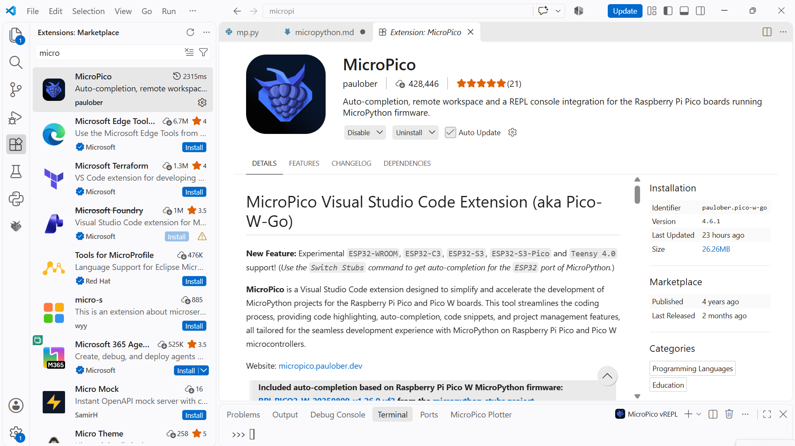
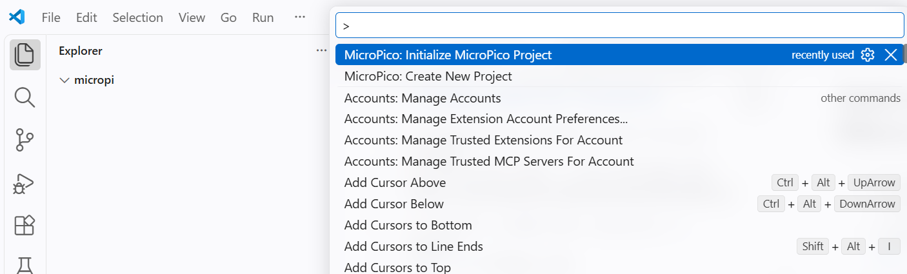
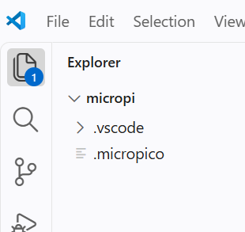

# Getting started with MicroPython

### 1) 
Connect your raspberry pico W to your computer.   

### 2) 
Follow the steps in the following link:
https://micropython.org/download/RPI_PICO_W/

  
### 3) 
Install the MicroPico extension in VSCode 


  
### 4) 
Make a folder in your preffered location called micropi
  
### 5) 
Open the folder in VSCode and use ctrl-shift-p to select MicroPico > Initialize MicroPico Project in the command pallette of VS code. 

  
Your folder should look like this:

  
### 6) 
Make a file in the micropi folder called "helloworld.py" and paste the following code:
``` python
from machine import Pin
from time import sleep

led = Pin("LED", Pin.OUT)

print("Blinking the LED 10 times...")
for i in range(20):
    led.value(i % 2 == 0)
    sleep(0.5)

led.off()
print("Done.")
```
  
The result: 

  
### 7) 
Open the folder in VSCode and use ctrl-shift-p to select MicroPico > Run Current File on Board 


### 8) Look at your pi. The led should blink 10 times...

