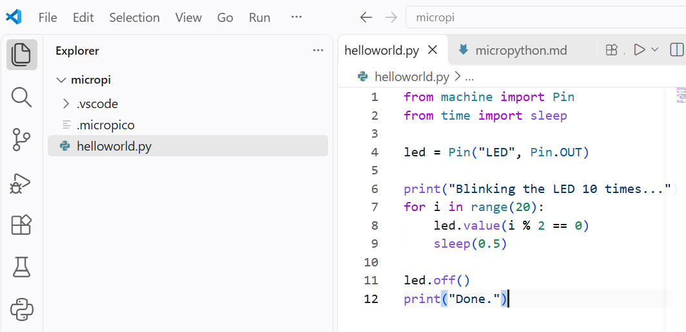
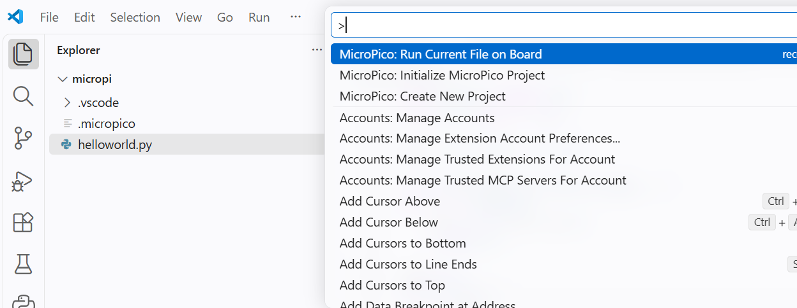

# Getting started with MicroPython

### Step 1
Connect your raspberry pico W to your computer.   

### Step 2
Follow the steps in the following link:
https://micropython.org/download/RPI_PICO_W/

  
### Step 3 
Install the MicroPico extension in VSCode 


  
### Step 4
Make a folder in your preffered location called micropi
  
### Step 5 
Open the folder in VSCode and use ctrl-shift-p to select MicroPico > Initialize MicroPico Project in the command pallette of VS code. 
  

  
Your folder should look like this:
  

  
### Step 6
Make a file in the micropi folder called "helloworld.py" and paste the following code:
``` python
from machine import Pin
from time import sleep

led = Pin("LED", Pin.OUT)

print("Blinking the LED 10 times...")
for i in range(20):
    led.value(i % 2 == 0)
    sleep(0.5)

led.off()
print("Done.")
```
    
The result:   
  

  
### Step 7
Open the folder in VSCode and use ctrl-shift-p to select MicroPico > Run Current File on Board 
  

  
### Step 8
Look at your pi. The led should blink 10 times...

